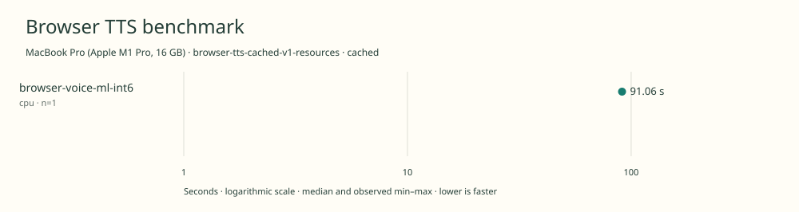

# 2026-11-25t06-05-14-820z-browser-voice-ml-int6-cpu-cached-5ff5cd42

MacBook Pro (Apple M1 Pro, 16 GB) · Apple M1 Pro · Google Chrome 158.0.8127.37

Protocol: **browser-tts-cached-v1-resources**, scenario **cached**. Native harness run.

First source-chunk request through final CPU-readable PCM; excludes initialization, validation, hashing, WAV encoding and save. Optional articleCallPeakRssBytes spans the entire browser call including post-timer validation/export. Generation RSS uses timestamped samples inside browser generation start/end boundaries; it includes the owned Chrome process tree and browser baseline.

| Model | Requested backend | Status | Median | Min–max | Runs |
|---|---|---|---:|---:|---:|
| browser-voice-ml-int6 | cpu | measured | 91.06 s | 91.06–91.06 s | 1 |

Additional metrics (median of available observations; scopes are distinct):

| Model | Backend | Metric | Median | Unit | n |
|---|---|---|---:|---|---:|
| browser-voice-ml-int6 | cpu | First completed source chunk | 989.095 | ms | 1 |
| browser-voice-ml-int6 | cpu | First PCM block | 989.075 | ms | 1 |
| browser-voice-ml-int6 | cpu | Generated audio | 1452.405 | s | 1 |
| browser-voice-ml-int6 | cpu | Generation / audio duration | 0.063 | ratio | 1 |
| browser-voice-ml-int6 | cpu | Model initialization | 701.294 | ms | 1 |
| browser-voice-ml-int6 | cpu | Complete controller trial including setup/export | 96213.129 | ms | 1 |
| browser-voice-ml-int6 | cpu | Transferred HTTP body data | 1930547 | bytes | 1 |
| browser-voice-ml-int6 | cpu | Ideal body transfer at 1 Mbps | 15.444 | s | 1 |
| browser-voice-ml-int6 | cpu | Whole-call Chrome process-tree peak RSS | 1614626816 | bytes | 1 |
| browser-voice-ml-int6 | cpu | Per-trial mean generation Chrome process-tree RSS | 1055195951 | bytes | 1 |
| browser-voice-ml-int6 | cpu | In-window Chrome RSS observations | 181.000 | samples | 1 |

Model support (catalog capability, not coverage of this run):

| Model | Supported voices | Bundled voices | Languages | Tested voice |
|---|---:|---:|---|---|
| browser-voice-ml-int6 | 1 | 1 | 1 (ml) | Jahnavi |

Jahnavi in the native Malayalam-script benchmark using the pinned compact INT6 checkpoint.. Native Malayalam-script fixture only. Stock pace scale is 0.9473172987974098 at UI speed 1. The publisher worker uses one-thread WebAssembly for acoustic and G2P sessions. Sources: [1](https://huggingface.co/Hansda/malayalam-voice-compact/tree/651bf3cbe3e9891bb298becaaff713033b0d384a), [2](https://huggingface.co/datasets/Hansda/malayalam-maya2-jahnavi-20h/blob/44b501c1e6688b61015c6ba4e07f6e17014731ca/README.md), [3](https://raw.githubusercontent.com/DarvinX/multilingual-browser-tts/f2977727b8baccb989f80b492ea8da00124ecba3/web/credits.html), [4](https://github.com/common-voice/common-voice/blob/605c25e48f9fb87cb25ca794cb39bf91d3741f29/server/data/ml/sentence-collector.txt), [5](https://huggingface.co/datasets/sulabhkatiyar/indic-tts-mini-24k/tree/8fe16c93456540d567f4ae952adb18ab173912b3/index/parts), [6](https://www.openslr.org/63/), [7](https://github.com/google-research-datasets/dakshina#native-script-wikipedia).

- **browser-voice-ml-int6 / cpu**: The released acoustic and G2P sessions use the one-thread WASM provider.

Capability checks run separately before timing. GPU dispatch does not imply GPU-exclusive execution.

Raw WAV is saved locally; opt-in audio publication is separate from timing and automatic result submission.

Campaign 2026-11-25T05-59-02-201Z-8fc5758f47f8; cell 2/2; source b5f7429ea828f0be1a16b194edbbddbffb9f77ab; fixture ml-article-v1 (ml, 23011 JavaScript characters, 105 spans); requested n=1; effective n=1; Headed Google Chrome, Apple M1 Pro, AC power. Published browser-voice-ml-int6, Jahnavi, INT6 packed weights expanded to FP32. Qualified backends: cpu. Sequential isolated profiles. Warm protocol v2 excludes the full article warmup.

RSS is sampled every 500 ms across the owned Chrome process tree, including the Chrome baseline and inference workers. Whole-call peak spans post-timer validation/export; generation mean uses only in-window samples from browser generation start through final CPU-readable PCM.

Different protocols, fixtures, settings or machines must not be pooled into a speedup ranking. This report does not rate speech quality.
