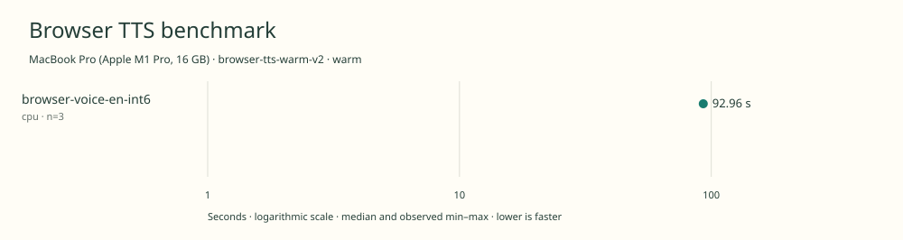

# 2026-11-25t06-15-45-084z-browser-voice-en-int6-cpu-warm-c5fd3db2

MacBook Pro (Apple M1 Pro, 16 GB) · Apple M1 Pro · Google Chrome 158.0.8127.37

Protocol: **browser-tts-warm-v2**, scenario **warm**. Native harness run.

First source-chunk request through final CPU-readable PCM; excludes initialization, validation, hashing, WAV encoding and save. Optional articleCallPeakRssBytes spans the entire browser call including post-timer validation/export.

| Model | Requested backend | Status | Median | Min–max | Runs |
|---|---|---|---:|---:|---:|
| browser-voice-en-int6 | cpu | measured | 92.96 s | 92.93–92.96 s | 3 |

Additional metrics (median of available observations; scopes are distinct):

| Model | Backend | Metric | Median | Unit | n |
|---|---|---|---:|---|---:|
| browser-voice-en-int6 | cpu | First completed source chunk | 1139.650 | ms | 3 |
| browser-voice-en-int6 | cpu | First PCM block | 1139.640 | ms | 3 |
| browser-voice-en-int6 | cpu | Generated audio | 1467.168 | s | 3 |
| browser-voice-en-int6 | cpu | Generation / audio duration | 0.063 | ratio | 3 |

Model support (catalog capability, not coverage of this run):

| Model | Supported voices | Bundled voices | Languages | Tested voice |
|---|---:|---:|---|---|
| browser-voice-en-int6 | 1 | 1 | 1 (en) | Nivedita |

Nivedita in the original English benchmark using the pinned compact INT6 checkpoint.. English \`english-20k-v1\` fixture only. The released stock pace scale is 1.0 at UI speed 1. The publisher worker uses one-thread WebAssembly for acoustic and G2P sessions. Sources: [1](https://huggingface.co/Hansda/english-voice-compact/tree/c62d91d51f1bb1e80a2337ec4b0b86f6cc438c63), [2](https://huggingface.co/datasets/Hansda/english-maya2-nivedita-20h/blob/d90ae476053ac26d9d85d41219a70a5d2651b4a3/README.md), [3](https://raw.githubusercontent.com/DarvinX/multilingual-browser-tts/f2977727b8baccb989f80b492ea8da00124ecba3/web/credits.html), [4](https://github.com/common-voice/common-voice/blob/605c25e48f9fb87cb25ca794cb39bf91d3741f29/server/data/en/sentence-collector.txt), [5](https://huggingface.co/maya-research/maya2-native/tree/87a83efdd6551e038246b6b37836a6264713eec3), [6](https://github.com/MayaResearch/maya2-native/tree/c6b376868e268551d065c4206193e96257bef4a1), [7](https://huggingface.co/kyutai/mimi).

- **browser-voice-en-int6 / cpu**: The released acoustic and G2P sessions use the one-thread WASM provider.

Capability checks run separately before timing. GPU dispatch does not imply GPU-exclusive execution.

Raw WAV is saved locally; opt-in audio publication is separate from timing and automatic result submission.

Campaign 2026-11-25T06-15-44-456Z-036f06ab17bc; cell 1/2; source e30fd6451fe4effd296e22f6fad0ceb04c57a0ae; fixture english-20k-v1 (en, 20000 JavaScript characters, 93 spans); requested n=3; effective n=3; Headed Google Chrome, Apple M1 Pro, AC power. Published browser-voice-en-int6, Nivedita, INT6 packed weights expanded to FP32. Qualified backends: cpu. Sequential isolated profiles. Warm protocol v2 excludes the full article warmup.

Different protocols, fixtures, settings or machines must not be pooled into a speedup ranking. This report does not rate speech quality.
