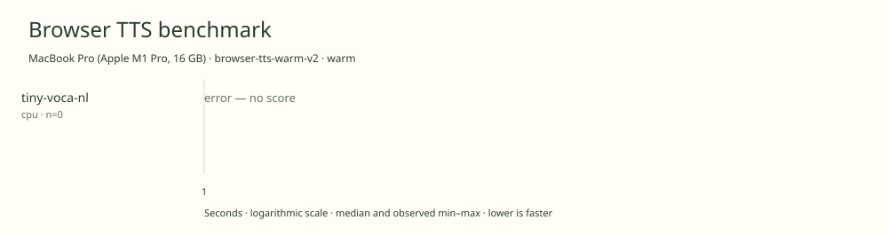

# 2026-11-25t12-44-02-213z-tiny-voca-nl-cpu-warm-ffb3e178

MacBook Pro (Apple M1 Pro, 16 GB) · Apple M1 Pro · Google Chrome 158.0.8127.37

Protocol: **browser-tts-warm-v2**, scenario **warm**. Native harness run.

First source-chunk request through final CPU-readable PCM; excludes initialization, validation, hashing, WAV encoding and save. Optional articleCallPeakRssBytes spans the entire browser call including post-timer validation/export.

| Model | Requested backend | Status | Median | Min–max | Runs |
|---|---|---|---:|---:|---:|
| tiny-voca-nl | cpu | error | — | — | 0 |

Model support (catalog capability, not coverage of this run):

| Model | Supported voices | Bundled voices | Languages | Tested voice |
|---|---:|---:|---|---|
| tiny-voca-nl | 1 | 1 | 1 (nl) | alex |

Pinned calibrated Dutch model and official Dutch browser frontend only. One bundled Alex voice \(index 0\), nl-NL, 24 kHz. Eligible fixture: nl-article-v1.. Experimental Dutch profile. Base model card reports 4,537,291 parameters; this is a lower bound because 4,053 calibrated-excitation values are also present and the graph has extra initializers. Publisher browser worker pins one-thread WASM, voice alex, speed 1, pitch 0/range 1, at most 256 tokens, 3,000 frames, recursive clause/word splits, per-utterance 0.99 peak cap and no inserted audio gaps. Calibrated excitation is stochastic and has no synthesis seed. The nl-article-v1 translation has no independent human review. Sources: [1](https://github.com/tetsuo/tiny-voca-nl/tree/63566400b13c184d10d6da1a563c4f6c7f3ccac5), [2](https://huggingface.co/xxy998/tiny-voca-nl/tree/ba761f35b72b76d473af2f1daea079944601c69f), [3](https://huggingface.co/spaces/xxy998/tiny-voca-nl/tree/cccbdddce753130c2d449225438c82b45af1d3da), [4](https://huggingface.co/rhasspy/piper-voices/tree/e929968c3761f1c281875787685a745863db838d/nl/nl_NL/alex/medium), [5](https://github.com/espeak-ng/espeak-ng/tree/4870adfa25b1a32b4361592f1be8a40337c58d6c).

- **tiny-voca-nl / cpu**: Pinned publisher browser path explicitly uses one-thread ONNX Runtime WASM; no GPU backend. page.evaluate: Error: Error: Tiny Voca Dutch source span 31 failed: Niet-ondersteunde Nederlandse klank: e     at generate (http://127.0.0.1:60494/web/workers/tiny-voca-nl.mjs:104:11)     at async self.onmessage (http://127.0.0.1:60494/web/workers/tiny-voca-nl.mjs:168:50)     at generate (http://127.0.0.1:60494/web/workers/tiny-voca-nl.mjs:104:11)     at async self.onmessage (http://127.0.0.1:60494/web/workers/tiny-voca-nl.mjs:168:50)     at worker.onmessage (http://127.0.0.1:60494/web/adapters/rpc-bridge.mjs:43:25)

Capability checks run separately before timing. GPU dispatch does not imply GPU-exclusive execution.

Raw WAV is saved locally; opt-in audio publication is separate from timing and automatic result submission.

Different protocols, fixtures, settings or machines must not be pooled into a speedup ranking. This report does not rate speech quality.
