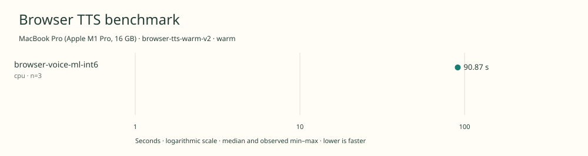

# 2026-11-25t17-44-39-430z-browser-voice-ml-int6-cpu-warm-2dbfba92

MacBook Pro (Apple M1 Pro, 16 GB) · Apple M1 Pro · Google Chrome 158.0.8127.37

Protocol: **browser-tts-warm-v2**, scenario **warm**. Native harness run.

First source-chunk request through final CPU-readable PCM; excludes initialization, validation, hashing, WAV encoding and save. Optional articleCallPeakRssBytes spans the entire browser call including post-timer validation/export.

| Model | Requested backend | Status | Median | Min–max | Runs |
|---|---|---|---:|---:|---:|
| browser-voice-ml-int6 | cpu | measured | 90.87 s | 90.86–90.90 s | 3 |

Additional metrics (median of available observations; scopes are distinct):

| Model | Backend | Metric | Median | Unit | n |
|---|---|---|---:|---|---:|
| browser-voice-ml-int6 | cpu | First completed source chunk | 811.650 | ms | 3 |
| browser-voice-ml-int6 | cpu | First PCM block | 811.645 | ms | 3 |
| browser-voice-ml-int6 | cpu | Generated audio | 1454.389 | s | 3 |
| browser-voice-ml-int6 | cpu | Generation / audio duration | 0.062 | ratio | 3 |

Model support (catalog capability, not coverage of this run):

| Model | Supported voices | Bundled voices | Languages | Tested voice |
|---|---:|---:|---|---|
| browser-voice-ml-int6 | 1 | 1 | 1 (ml) | Jahnavi |

Jahnavi speaks Malayalam from Malayalam script or Roman input using the published INT6 checkpoint.. Malayalam script and Roman Malayalam have separate registered articles. The stock Roman frontend uses the Dakshina-derived dictionary. Stock pace scale is 0.9473172987974098 at UI speed 1. The publisher worker uses one-thread WebAssembly for acoustic and G2P sessions. Sources: [1](https://huggingface.co/Hansda/malayalam-voice-compact/tree/651bf3cbe3e9891bb298becaaff713033b0d384a), [2](https://huggingface.co/datasets/Hansda/malayalam-maya2-jahnavi-20h/blob/44b501c1e6688b61015c6ba4e07f6e17014731ca/README.md), [3](https://raw.githubusercontent.com/DarvinX/multilingual-browser-tts/f2977727b8baccb989f80b492ea8da00124ecba3/web/credits.html), [4](https://github.com/common-voice/common-voice/blob/605c25e48f9fb87cb25ca794cb39bf91d3741f29/server/data/ml/sentence-collector.txt), [5](https://huggingface.co/datasets/sulabhkatiyar/indic-tts-mini-24k/tree/8fe16c93456540d567f4ae952adb18ab173912b3/index/parts), [6](https://www.openslr.org/63/), [7](https://github.com/google-research-datasets/dakshina#native-script-wikipedia), [8](https://github.com/google-research-datasets/dakshina).

- **browser-voice-ml-int6 / cpu**: The released acoustic and G2P sessions use the one-thread WASM provider.

Capability checks run separately before timing. GPU dispatch does not imply GPU-exclusive execution.

Raw WAV is saved locally; opt-in audio publication is separate from timing and automatic result submission.

Campaign 2026-11-25T17-44-38-770Z-93d56eed03e8; cell 1/2; source 8122617761575975dca03057140e7c33481d5b98; fixture ml-latn-article-v1 (ml-Latn, 25594 JavaScript characters, 116 spans); requested n=3; effective n=3; Headed Google Chrome, Apple M1 Pro, AC power. Published browser-voice-ml-int6, Jahnavi, INT6 packed weights expanded to FP32. Qualified backends: cpu. Sequential isolated profiles. Warm protocol v2 excludes the full article warmup.

Different protocols, fixtures, settings or machines must not be pooled into a speedup ranking. This report does not rate speech quality.
