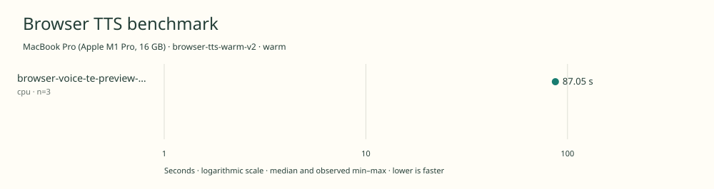

# 2026-11-25t18-02-15-937z-browser-voice-te-preview-int8-cpu-warm-8daf84bd

MacBook Pro (Apple M1 Pro, 16 GB) · Apple M1 Pro · Google Chrome 158.0.8127.37

Protocol: **browser-tts-warm-v2**, scenario **warm**. Native harness run.

First source-chunk request through final CPU-readable PCM; excludes initialization, validation, hashing, WAV encoding and save. Optional articleCallPeakRssBytes spans the entire browser call including post-timer validation/export.

| Model | Requested backend | Status | Median | Min–max | Runs |
|---|---|---|---:|---:|---:|
| browser-voice-te-preview-int8 | cpu | measured | 87.05 s | 86.99–87.11 s | 3 |

Additional metrics (median of available observations; scopes are distinct):

| Model | Backend | Metric | Median | Unit | n |
|---|---|---|---:|---|---:|
| browser-voice-te-preview-int8 | cpu | First completed source chunk | 809.205 | ms | 3 |
| browser-voice-te-preview-int8 | cpu | First PCM block | 809.185 | ms | 3 |
| browser-voice-te-preview-int8 | cpu | Generated audio | 1426.901 | s | 3 |
| browser-voice-te-preview-int8 | cpu | Generation / audio duration | 0.061 | ratio | 3 |

Model support (catalog capability, not coverage of this run):

| Model | Supported voices | Bundled voices | Languages | Tested voice |
|---|---:|---:|---|---|
| browser-voice-te-preview-int8 | 1 | 1 | 1 (te) | Sreekar |

Sreekar speaks Telugu from Telugu script or Roman input using the published PREVIEW-INT8 checkpoint.. Telugu script and Roman Telugu have separate registered articles. The stock Roman frontend uses the Dakshina-derived dictionary. Publisher worker uses one-thread WebAssembly for acoustic and G2P sessions. Preview checkpoint terms are unresolved and require acceptance. Sources: [1](https://tts.hansda.in/?lang=te), [2](https://tts.hansda.in/credits.html), [3](https://github.com/DarvinX/multilingual-browser-tts/tree/f2977727b8baccb989f80b492ea8da00124ecba3), [4](https://huggingface.co/datasets/Hansda/telugu-maya2-sreekar-20h/blob/63713495116f46b9a5b0a56ca06ec23059841034/README.md), [5](https://github.com/google-research-datasets/dakshina).

- **browser-voice-te-preview-int8 / cpu**: The released acoustic and G2P sessions use the one-thread WASM provider.

Capability checks run separately before timing. GPU dispatch does not imply GPU-exclusive execution.

Raw WAV is saved locally; opt-in audio publication is separate from timing and automatic result submission.

Campaign 2026-11-25T18-02-15-299Z-c054b9040872; cell 1/2; source 8ee165d13083d9f6fa75bcf731421c2fb6dac98f; fixture te-latn-article-v1 (te-Latn, 24747 JavaScript characters, 113 spans); requested n=3; effective n=3; Headed Google Chrome, Apple M1 Pro, AC power. Published browser-voice-te-preview-int8, Sreekar, INT8 preview packed weights expanded to FP32. Qualified backends: cpu. Sequential isolated profiles. Warm protocol v2 excludes the full article warmup.

Different protocols, fixtures, settings or machines must not be pooled into a speedup ranking. This report does not rate speech quality.
