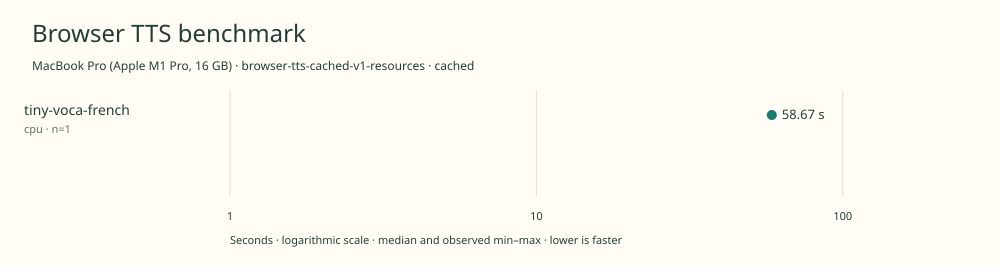

# 2026-11-25t18-24-26-920z-tiny-voca-french-cpu-cached-31cdb2cf

MacBook Pro (Apple M1 Pro, 16 GB) · Apple M1 Pro · Google Chrome 158.0.8127.37

Protocol: **browser-tts-cached-v1-resources**, scenario **cached**. Native harness run.

First source-chunk request through final CPU-readable PCM; excludes initialization, validation, hashing, WAV encoding and save. Optional articleCallPeakRssBytes spans the entire browser call including post-timer validation/export. Generation RSS uses timestamped samples inside browser generation start/end boundaries; it includes the owned Chrome process tree and browser baseline.

| Model | Requested backend | Status | Median | Min–max | Runs |
|---|---|---|---:|---:|---:|
| tiny-voca-french | cpu | measured | 58.67 s | 58.67–58.67 s | 1 |

Additional metrics (median of available observations; scopes are distinct):

| Model | Backend | Metric | Median | Unit | n |
|---|---|---|---:|---|---:|
| tiny-voca-french | cpu | First completed source chunk | 612.875 | ms | 1 |
| tiny-voca-french | cpu | First PCM block | 236.290 | ms | 1 |
| tiny-voca-french | cpu | Generated audio | 1230.699 | s | 1 |
| tiny-voca-french | cpu | Generation / audio duration | 0.048 | ratio | 1 |
| tiny-voca-french | cpu | Model initialization | 5445.193 | ms | 1 |
| tiny-voca-french | cpu | Complete controller trial including setup/export | 68038.790 | ms | 1 |
| tiny-voca-french | cpu | Transferred HTTP body data | 101631 | bytes | 1 |
| tiny-voca-french | cpu | Ideal body transfer at 1 Mbps | 0.813 | s | 1 |
| tiny-voca-french | cpu | Whole-call Chrome process-tree peak RSS | 1687322624 | bytes | 1 |
| tiny-voca-french | cpu | Per-trial mean generation Chrome process-tree RSS | 1433348308 | bytes | 1 |
| tiny-voca-french | cpu | In-window Chrome RSS observations | 116.000 | samples | 1 |

Model support (catalog capability, not coverage of this run):

| Model | Supported voices | Bundled voices | Languages | Tested voice |
|---|---:|---:|---|---|
| tiny-voca-french | 5 | 5 | 1 (fr) | F1 |

French, five bundled voices. The benchmark uses F1 at index 0 with one WebAssembly thread.. F1 is a synthetic voice. The browser adapter matched the publisher’s pronunciation inputs across the full French article and sample counts on its opening three segments. The qualification record contains waveform comparisons. The SIWIS-derived SW voice is outside this benchmark. Sources: [1](https://huggingface.co/ymelka/tiny-voca-french/tree/502ebbc0b9d442d056da1ef60926646394a2dbc8), [2](https://github.com/yoch/tiny-voca/tree/9662a249d8ced6957d9f85665468f93df84fbea8), [3](https://huggingface.co/spaces/ymelka/tiny-voca-french/tree/8ddb95dc20e47864cc9c5c3754aac331f2db1d6b), [4](https://www.npmjs.com/package/onnxruntime-web/v/1.20.1).

- **tiny-voca-french / cpu**: Official Space uses ONNX Runtime Web 1.20.1 with explicit single-thread WASM.

Capability checks run separately before timing. GPU dispatch does not imply GPU-exclusive execution.

Raw WAV is saved locally; opt-in audio publication is separate from timing and automatic result submission.

Campaign 2026-11-25T18-20-15-452Z-280ac166d14b; cell 2/2; source e3f1670996ee35c33c1bab0e120fdac68e7d98ac; fixture fr-article-v1 (fr, 23757 JavaScript characters, 108 spans); requested n=1; effective n=1; Headed Google Chrome, Apple M1 Pro, AC power. Published tiny-voca-french, F1, FP32 ONNX. Qualified backends: cpu. Sequential isolated profiles. Warm protocol v2 excludes the full article warmup.

RSS is sampled every 500 ms across the owned Chrome process tree, including the Chrome baseline and inference workers. Whole-call peak spans post-timer validation/export; generation mean uses only in-window samples from browser generation start through final CPU-readable PCM.

Different protocols, fixtures, settings or machines must not be pooled into a speedup ranking. This report does not rate speech quality.
