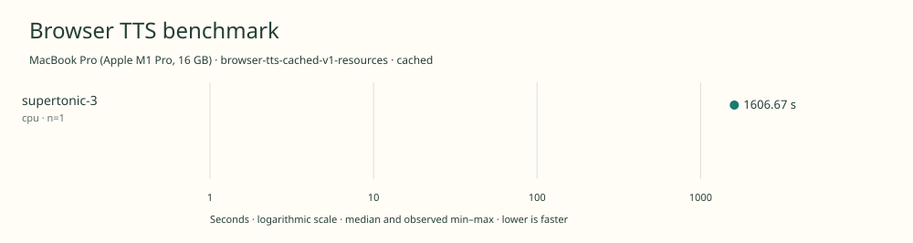

# 2026-11-27t02-33-53-620z-supertonic-3-cpu-cached-32fae9ee

MacBook Pro (Apple M1 Pro, 16 GB) · Apple M1 Pro · Google Chrome 158.0.8127.37

Protocol: **browser-tts-cached-v1-resources**, scenario **cached**. Native harness run.

First source-chunk request through final CPU-readable PCM; excludes initialization, validation, hashing, WAV encoding and save. Optional articleCallPeakRssBytes spans the entire browser call including post-timer validation/export. Generation RSS uses timestamped samples inside browser generation start/end boundaries; it includes the owned Chrome process tree and browser baseline.

| Model | Requested backend | Status | Median | Min–max | Runs |
|---|---|---|---:|---:|---:|
| supertonic-3 | cpu | measured | 1606.67 s | 1606.67–1606.67 s | 1 |

Additional metrics (median of available observations; scopes are distinct):

| Model | Backend | Metric | Median | Unit | n |
|---|---|---|---:|---|---:|
| supertonic-3 | cpu | First completed source chunk | 14880.875 | ms | 1 |
| supertonic-3 | cpu | First PCM block | 14880.860 | ms | 1 |
| supertonic-3 | cpu | Generated audio | 1380.325 | s | 1 |
| supertonic-3 | cpu | Generation / audio duration | 1.164 | ratio | 1 |
| supertonic-3 | cpu | Model initialization | 1925.013 | ms | 1 |
| supertonic-3 | cpu | Complete controller trial including setup/export | 1616262.744 | ms | 1 |
| supertonic-3 | cpu | Transferred HTTP body data | 358055139 | bytes | 1 |
| supertonic-3 | cpu | Ideal body transfer at 1 Mbps | 2864.441 | s | 1 |
| supertonic-3 | cpu | Whole-call Chrome process-tree peak RSS | 2165964800 | bytes | 1 |
| supertonic-3 | cpu | Per-trial mean generation Chrome process-tree RSS | 1401486234 | bytes | 1 |
| supertonic-3 | cpu | In-window Chrome RSS observations | 3200.000 | samples | 1 |

Model support (catalog capability, not coverage of this run):

| Model | Supported voices | Bundled voices | Languages | Tested voice |
|---|---:|---:|---|---|
| supertonic-3 | 10 | 1 | 31 | M3 (Robert) |

Pinned Supertonic 3 checkpoint and ten supplied preset voice styles. Ten supplied presets F1–F5 and M1–M5; M3 \(Robert\) is staged for this profile. The Spain Spanish and Brazilian Portuguese article editions use the native es and pt tags. Language-agnostic mode na is excluded from the language count. Eight denoising steps and effective speed 1.05 match the linked demo defaults \(UI speed 1.0\). Sources: [1](https://huggingface.co/Supertone/supertonic-3/blob/3cadd1ee6394adea1bd021217a0e650ede09a323/README.md), [2](https://huggingface.co/Supertone/supertonic-3/tree/3cadd1ee6394adea1bd021217a0e650ede09a323/voice_styles), [3](https://huggingface.co/spaces/Supertone/supertonic-3/blob/4402acca094e2ff2b3dff446e0bf915f3fccc462/script.js).

- **supertonic-3 / cpu**: Explicit one-thread ONNX Runtime Web WASM provider; model text processing runs in the Chrome worker.

Capability checks run separately before timing. GPU dispatch does not imply GPU-exclusive execution.

Raw WAV is saved locally; opt-in audio publication is separate from timing and automatic result submission.

Campaign 2026-11-27T00-46-17-387Z-3d9582335592; cell 2/2; source 42f5d466737d91eb9a524ab1b01171e761740b2f; fixture id-article-v1 (id, 22169 JavaScript characters, 101 spans); requested n=1; effective n=1; Supertonic 3 FP32 M3, Apple M1 Pro, AC power, headed Chrome, disposable profiles, sequential inference. Eight denoising steps and speed 1.05. Verified Apple WebGPU dispatch with some WASM operators, or explicit one-thread CPU/WASM. An earlier Indonesian attempt was interrupted before its first score because a separate Chrome CPU diagnostic overlapped its warmup and first timed article. All three scores come from this new full campaign in a fresh profile.

RSS is sampled every 500 ms across the owned Chrome process tree, including the Chrome baseline and inference workers. Whole-call peak spans post-timer validation/export; generation mean uses only in-window samples from browser generation start through final CPU-readable PCM.

Different protocols, fixtures, settings or machines must not be pooled into a speedup ranking. This report does not rate speech quality.
