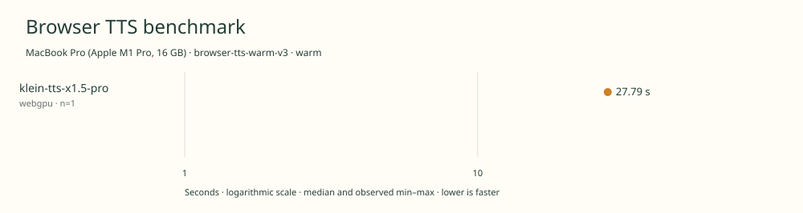

# 2026-11-28t08-02-26-332z-klein-tts-x1.5-pro-webgpu-warm-e751eab4

MacBook Pro (Apple M1 Pro, 16 GB) · Apple M1 Pro · Google Chrome 158.0.8127.37

Protocol: **browser-tts-warm-v3**, scenario **warm**. Native harness run.

First source-chunk request through final CPU-readable PCM; excludes initialization, validation, hashing, WAV encoding and save. Optional articleCallPeakRssBytes spans the entire browser call including post-timer validation/export.

| Model | Requested backend | Status | Median | Min–max | Runs |
|---|---|---|---:|---:|---:|
| klein-tts-x1.5-pro | webgpu | measured | 27.79 s | 27.79–27.79 s | 1 |

Additional metrics (median of available observations; scopes are distinct):

| Model | Backend | Metric | Median | Unit | n |
|---|---|---|---:|---|---:|
| klein-tts-x1.5-pro | webgpu | First completed source chunk | 269.615 | ms | 1 |
| klein-tts-x1.5-pro | webgpu | First PCM block | 269.600 | ms | 1 |
| klein-tts-x1.5-pro | webgpu | Generated audio | 1394.200 | s | 1 |
| klein-tts-x1.5-pro | webgpu | Generation / audio duration | 0.020 | ratio | 1 |

Chrome process-tree RSS during the excluded full-article warm-up. The scored article runs without RSS sampling.

| Model | Backend | Mean RSS (MB) | Samples |
|---|---|---:|---:|
| klein-tts-x1.5-pro | webgpu | 1976.49 | 56 |

Model support (catalog capability, not coverage of this run):

| Model | Supported voices | Bundled voices | Languages | Tested voice |
|---|---:|---:|---|---|
| klein-tts-x1.5-pro | 17 | 17 | 4 (en, es, fr, it) | Giulia (if_sara) |

Pinned Klein-TTS X1.5 Pro ONNX checkpoint. The benchmark selects Sarah \(af\_heart\) for English, Lucia \(ef\_dora\) for Spanish, Camille \(ff\_siwis\) for French, and Giulia \(if\_sara\) for Italian. Sources: [1](https://huggingface.co/klein-ml/Klein-TTS-X1.5-Pro/blob/25e0e73bebba71e5985bc369628ebdcb81bf7116/README.md), [2](https://huggingface.co/klein-ml/Klein-TTS-X1.5-Pro/blob/25e0e73bebba71e5985bc369628ebdcb81bf7116/onnx/model.json).

- **klein-tts-x1.5-pro / webgpu**: Non-fallback hardware adapter apple; observed 1343 compute dispatches in a separate untimed probe. WebGPU with possible WASM operator fallback; eSpeak preprocessing and CPU-readable PCM readback are CPU work.

Capability checks run separately before timing. GPU dispatch does not imply GPU-exclusive execution.

Raw WAV is saved locally; opt-in audio publication is separate from timing and automatic result submission.

Campaign 2026-11-28T07-52-43-053Z-4e7c9f10c67f; cell 2/2; source 4d44a9a632462fbfb2958e1619904988c616287e; fixture it-article-v1 (it, 23584 JavaScript characters, 107 spans); requested n=1; effective n=1; Native arm64 Apple M1 Pro MacBook Pro with 8 CPU cores and 16 GiB RAM on AC power. Sequential disposable headed Chrome profiles. Warm v3 measures Chrome process-tree RSS during its excluded full-article warm-up.

Warm v3 samples 500 ms Chrome process-tree RSS only during the excluded full-article warm-up; the single scored article runs with RSS sampling disabled.

Different protocols, fixtures, settings or machines must not be pooled into a speedup ranking. This report does not rate speech quality.
